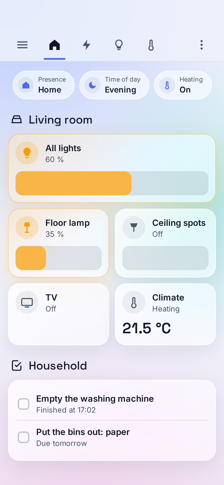
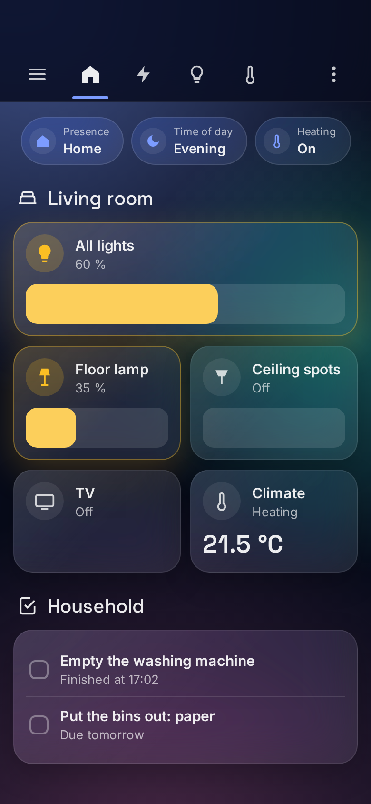

# Opal

[](https://github.com/hacs/integration)
[](https://github.com/tb1337/home-assistant-opal-theme/actions/workflows/validate.yml)
[](LICENSE)

A Home Assistant theme with frosted-glass cards over soft coloured light, like an opal: milky
glass with colours shimmering through. One theme, a light and a dark mode.

| Light | Dark |
|:---:|:---:|
|  |  |

<sub>Illustrative previews of a phone dashboard in Opal (with card-mod); your own cards will differ.</sub>

## Features

- **Frosted-glass cards**: translucent cards with backdrop blur and extra saturation, a fine
  border and a soft shadow.
- **Soft coloured light**: three blurred light spots (periwinkle, teal, pink) behind every
  dashboard; they stay in place while you scroll.
- **Light and dark mode**: pale blue-grey with white glass, or night blue with dark glass. Pick
  one or let Home Assistant follow your device.
- **Readable forms and menus**: glass form fields and selects, opaque drop-down menus, glass
  dialogs that blur what is behind them.
- **With [card-mod](https://github.com/thomasloven/lovelace-card-mod)** (optional):
  - a frosted-glass dashboard header,
  - a subtle light sheen on every card,
  - active tiles (light on, device running) glow in their state colour.

## Requirements

- Home Assistant 2026.11 or newer.
- Optional, recommended: [card-mod](https://github.com/thomasloven/lovelace-card-mod) for the
  header, the card sheen and the glowing tiles. Without it, Opal works and those three are
  simply left out.

## Installation

### Marketplace / HACS

1. In Home Assistant open **Settings → Marketplace** (HACS on older versions).
2. Add this repository as a custom repository of type **Theme**:
   `https://github.com/tb1337/home-assistant-opal-theme`.
3. Search for **Opal** and download it.

### Manual

Copy [`themes/opal.yaml`](themes/opal.yaml) to `config/themes/opal.yaml`.

### Enable themes

If you have not done so yet, load themes from that folder in `configuration.yaml` and restart
Home Assistant:

```yaml
frontend:
  themes: !include_dir_merge_named themes/
```

Later changes to the file only need **Developer tools → Actions → `frontend.reload_themes`**.

### Select it

Open your **profile**, choose **Opal** under *Theme*, then **Auto**, **Light** or **Dark**.

## card-mod

Install card-mod from the Marketplace. It works as a dashboard resource; for themes it applies
most reliably when it is also loaded as an extra module, so it is ready before the first page
renders:

```yaml
frontend:
  themes: !include_dir_merge_named themes/
  extra_module_url:
    - /local/community/lovelace-card-mod/card-mod.js
```

## Customising

- **Accent colour**: change `primary-color`, `accent-color` and their `rgb-*` values in the
  mode you want (light and dark have their own, the light one is darker for contrast).
- **Blur**: `ha-card-backdrop-filter` (cards) and `ha-dialog-surface-backdrop-filter`
  (dialogs).
- **Roundness**: `ha-card-border-radius` (cards), `ha-border-radius-sm` (small elements such as
  fields and chips).
- **Background**: `lovelace-background` per mode; replace it with an image if you like
  (`center / cover no-repeat fixed url('/local/your-image.jpg')`).

## Known limitations

- **Fonts**: a theme cannot load web fonts. Opal asks for Inter and Space Grotesk and falls back
  to the system font (San Francisco on Apple devices) when they are not installed.
- **Header blur in the iOS app**: the glass header is blurred in browsers; in the Home Assistant
  iOS app the blur may not apply, so the header is kept nearly opaque to stay readable.
- **Custom cards** follow the theme as far as they use Home Assistant's variables; some draw
  their own colours.

## Credits

Inspired by the structure of
[basnijholt/lovelace-ios-themes](https://github.com/basnijholt/lovelace-ios-themes).

## License

[MIT](LICENSE)
